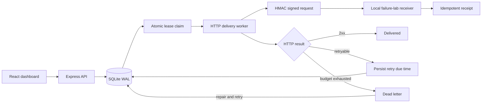

# RelayDesk

A webhook delivery workbench built with React, TypeScript, Node.js, Express, and SQLite. Send synthetic events to real local HTTP receivers, watch automatic retries, inspect signed delivery attempts, and recover failed work without deleting its history.

This project complements an applied ML portfolio with backend engineering: transactions, idempotency, durable queues, lease ownership, request authentication, API validation, and a usable operations dashboard. It is a local development tool, not a hosted multi-tenant service.

## Run it

Install **Node.js 24**. The Node version matters because the backend uses the built-in `node:sqlite` module. No API keys, Python, database server, or billing account is required.

```sh
npm ci
npm run build
npm start
```

Open **http://127.0.0.1:4328**. Data persists in `data/relaydesk.sqlite` across restarts. On this Windows computer, after setup you can also double-click **Start RelayDesk.cmd**; its optional bundled-runtime fallback does not require changing the system Node installation.

For frontend development, keep `npm run dev:api` and `npm run dev:ui` running in separate terminals. Vite proxies the API to port 4328; the finished build is served from the backend's origin.

## Three-minute demo

1. Click **Run failure demo**. This creates three synthetic orders and intentionally submits the healthy order twice with the same idempotency key. These are sample business events, not customer data.
2. Watch the healthy receiver succeed. The flaky receiver returns two HTTP 503 responses before accepting the third attempt. The failing receiver exhausts four attempts and moves to dead letter. The worker sends actual HTTP requests in the background; the page does not simulate queue state.
3. Open a delivery to inspect its JSON payload, response codes, timestamps, and attempt history. The duplicate submission created no second event or delivery.
4. Open **Endpoints**, switch the failing receiver to **Healthy**, then retry its dead-letter delivery. The same delivery succeeds with its previous failures still visible.
5. Create your own event in the new-event form. Reuse its idempotency key with identical content to get the existing event; change the payload under that key to see an HTTP 409 conflict.

The included receivers are intentionally local. There is no arbitrary outbound URL field. This keeps the failure lab repeatable and prevents turning the server into an unrestricted network proxy.

## Engineering decisions

- **Atomic ingestion.** `BEGIN IMMEDIATE` protects event creation, idempotency checks, and delivery fan-out in one transaction. A missing or disabled destination leaves no partially created event. A unique idempotency key plus a canonical SHA-256 request fingerprint distinguishes legitimate replay from conflicting reuse.
- **Durable work.** SQLite stores events, delivery state, attempts, retry due times, leases, and receiver receipts. WAL, foreign keys, and `synchronous=FULL` are configured. This is a single-host design; synchronous database operations and one database file are deliberate limitations.
- **Crash recovery.** Claiming work inserts an attempt and assigns an expiring, random lease token atomically. Another worker can reclaim expired work. Finishing a request checks the token, so an old worker cannot overwrite the new owner's result. Aborting shutdown leaves work recoverable.
- **Controlled retries.** Network failures, HTTP 408/425/429, and 5xx responses use exponential backoff with +/-20% jitter, a cap, and a finite attempt budget. Other non-success responses fail immediately. Replaying dead-letter work adds a new four-attempt budget and preserves all previous attempts.
- **Authenticated requests.** Each destination has a random signing secret stored only in the local database. HMAC-SHA256 binds the event ID, timestamp, and exact request bytes. Receivers use constant-time comparison and reject signatures outside a five-minute window. Secrets are excluded from API responses.
- **At-least-once semantics.** A receiver may accept work before the sender loses its response. A unique receiver receipt for `(endpoint_id,event_id)` prevents a second logical acceptance. This demonstrates receiver idempotency; it does not promise universal exactly-once delivery.
- **Bounded HTTP work.** The worker limits concurrency, enforces timeouts, rejects redirects, and cancels response streams once the bounded excerpt is collected. Only known local receiver paths are constructed.
- **Honest observability.** Counts, recovery rates, latency, and hourly activity come from persisted attempts. A dashboard with no events starts empty rather than showing fabricated activity.



## Verification

```sh
npm test
npm run build
```

Tests cover transactional fan-out, concurrent HTTP submissions, canonical key reuse, conflicting reuse, disabled destinations, lease fencing across database connections, expired final attempts, reopen persistence, retry budgets and jitter, permanent failures, HMAC tampering and expiry, receiver duplicate suppression, real metrics, worker timeouts and concurrency, cancellation, response stream bounds, HTTP validation, and Host/Origin defenses. Build checks the frontend with TypeScript before producing the browser bundle.

The GitHub Actions workflow runs these checks when the repository is pushed. An included workflow is not evidence of a completed CI run; local verification results are recorded separately in `docs/verification.md`.

## Container setup

```sh
docker compose up --build
```

The configuration binds the published port to `127.0.0.1`, runs the app as the unprivileged Node user, and persists the SQLite database in a named volume. The image performs a multi-stage frontend build and includes a health check. Docker Desktop must be running to build or run it. See the verification notes for whether this environment actually exercised the container.

## API examples

The complete request/response shapes are in [the API contract](docs/api-contract.md). List destinations with `GET /api/endpoints`, then create an event:

```json
{
  "type": "order.created",
  "payload": { "demo": true, "orderId": "demo-101", "quantity": 1 },
  "endpointIds": ["replace-with-an-id-from-the-endpoints-api"],
  "idempotencyKey": "demo-101"
}
```

POST the object to `/api/events` with `Content-Type: application/json`. Successful creation returns 202; an identical replay returns 200 with `replayed: true`; conflicting reuse returns 409. Bodies are limited to 16 KiB. Event types accept letters, numbers, dots, colons, hyphens, and underscores and must begin with a letter. Keys accept the same characters and are limited to 128 characters.

## Scope and production follow-ups

The server binds loopback by default and rejects untrusted Host headers and browser mutation origins. This is **not an authentication system**: any local process with access to the service can use its API. Do not expose it as a public service without authentication, authorization, TLS, tenant isolation, quotas, and deployment monitoring.

Current limitations include local demo receivers, a single-host SQLite database, no cross-machine queue coordination, no external destination management, no secret-rotation UI, and no measured production load or availability claim. SQLite connection tests establish claim/fencing correctness for this implementation, not distributed-system scalability. A natural next step is PostgreSQL-backed claims with `SKIP LOCKED` and authenticated, allowlisted external destinations.

## Interview and resume

[Interview walkthrough and resume bullets](docs/interview-guide.md) explain the trade-offs and how to demonstrate failure recovery. Understand and modify the implementation before presenting it; the repository includes AI-assisted code and should be represented honestly.

## Project map

```text
src/backend/store.js     SQL schema, transactions, leases, metrics, receivers
src/backend/worker.js    Concurrent HTTP delivery, timeouts, shutdown
src/backend/signing.js   HMAC request signing and verification
src/backend/server.js    HTTP API, validation, origin guards, static UI
src/frontend/            React dashboard and typed API client
tests/                   Core, HTTP integration, and reliability checks
docs/                    Contract, walkthrough, verification results
```
